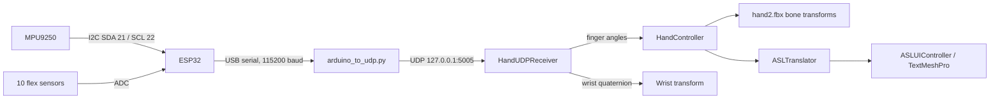

# Architecture and communication protocol

## Runtime data path



## Serial and UDP packet

The Arduino emits one line in this exact order:

| Index | Field | Meaning |
|---:|---|---|
| 0 | `q0` | Madgwick quaternion scalar component |
| 1 | `q1` | Quaternion x component |
| 2 | `q2` | Quaternion y component |
| 3 | `q3` | Quaternion z component |
| 4 | `thumbMCP` | Thumb MCP flex resistance, ohms |
| 5 | `thumbPIP` | Thumb PIP flex resistance, ohms |
| 6 | `indexMCP` | Index MCP flex resistance, ohms |
| 7 | `indexPIP` | Index PIP flex resistance, ohms |
| 8 | `middleMCP` | Middle MCP flex resistance, ohms |
| 9 | `middlePIP` | Middle PIP flex resistance, ohms |
| 10 | `ringMCP` | Ring MCP flex resistance, ohms |
| 11 | `ringPIP` | Ring PIP flex resistance, ohms |
| 12 | `pinkyMCP` | Pinky MCP flex resistance, ohms |
| 13 | `pinkyPIP` | Pinky PIP flex resistance, ohms |

The Arduino prints quaternion values to six decimal places. Flex values are printed using Arduino's default floating-point formatting. The line ends with `Serial.println`, which adds a newline.

The Python process calls `ser.readline()`, decodes ASCII while ignoring undecodable bytes, strips whitespace, and forwards the remaining text as one UDP datagram. It does not parse or transform the values.

## Unity receiver

`Assets/HandUDPReceiver.cs` binds a `UdpClient` to `listenPort` (default 5005). It splits each datagram on commas and accepts messages with at least 14 fields. It parses the quaternion from fields 0–3 and applies finger calibration to fields 6–13. Fields 4–5 are currently ignored because both thumb mapping calls are commented out.

### Wrist orientation

The receiver constructs a quaternion from `(q1, q2, q3, q0)`, then swaps x/y again when assigning `imuRotation`. Pressing `C` saves the current `imuRotation` as `neutralRot`. After calibration, it computes the relative rotation against that neutral pose, applies `rotationAmplifier`, and smooths using spherical interpolation.

### Finger-angle conversion

`ApplyFingerAngle` parses a resistance, clamps it between the configured bent and straight calibration values, maps the normalized range to `0..maxAngle`, then smooths the stored angle:

```text
normalized = (straight - raw) / (straight - bent)
angle = Lerp(0, maxAngle, normalized)
fingerValue = Lerp(previousValue, angle, fingerSmooth)
```

This formula assumes the calibrated `straight` resistance is greater than `bent` resistance. Each sensor must be calibrated against the actual glove and resistor divider.

### Hand bone animation

`HandController` stores the starting local rotations of each bone in `Awake()`. In `Update()`, it applies MCP and PIP angles to the first two bones and derives DIP as `PIP * 0.65`. Thumb movement is implemented separately using the CMC and IP angle fields.

### Letter recognition and UI

`ASLTranslator` reads `HandController` angle fields and applies ordered boolean conditions for a subset of static ASL handshapes. The first matching condition is returned. It is not a dynamic gesture recognizer.

`ASLUIController` enables accumulation with `Q`, disables it with `E`, and appends a newly detected character to a TextMeshPro field. It suppresses consecutive repetitions of the same character.
