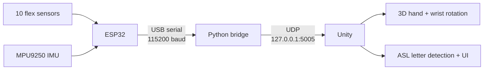

# ASL Interpreter

**A smart glove that mirrors your hand in 3D and tries to recognise ASL letters.**
Ten flex sensors and an IMU on an ESP32 stream hand pose over USB to a Python bridge, which forwards it to a Unity scene where a 3D hand moves in real time.


> [!WARNING]
> **Prototype, not a finished translator.** This is a recovered project that has not been re-tested end to end since recovery: the Unity project hasn't been re-opened, the scripts haven't been recompiled, and the glove hasn't been re-run. Letter recognition is rough (see [Known limitations](#known-limitations)) and has not been validated for real-world or educational use.

<!--
  Add a screenshot or GIF of the Unity hand moving with the glove here, e.g.:
  
-->

## Contents

- [How it works](#how-it-works)
- [What you need](#what-you-need)
- [Quick start](#quick-start)
- [Controls](#controls)
- [Data format](#data-format)
- [Known limitations](#known-limitations)
- [Roadmap](#roadmap)
- [Troubleshooting](#troubleshooting)
- [Repository layout](#repository-layout)
- [License](#license)

## How it works



| Stage | What happens |
| --- | --- |
| **Glove (ESP32)** | Reads the MPU9250 and ten flex-sensor voltage dividers. A Madgwick filter turns IMU data into a quaternion, and flex readings are converted to resistance. |
| **Bridge (Python)** | Reads each serial line and forwards it unchanged as a UDP packet. |
| **Unity** | Listens on UDP port `5005`, parses 14 values per packet, rotates the wrist, bends the finger bones, and checks the finger angles against hard-coded letter rules. |

## What you need

**Hardware**

- ESP32 development board supported by the Arduino IDE
- MPU9250 IMU
- 10 flex sensors, plus the fixed resistors for their voltage dividers (values and wiring in [Hardware-and-Dependencies.md](Documentation/Hardware-and-Dependencies.md))
- USB **data** cable (charge-only cables won't show up as a serial port)

**Software**

| Tool | Version |
| --- | --- |
| Arduino IDE | any recent version, with ESP32 board support |
| A library providing `MadgwickAHRS.h` | exact package not recorded, see [DEPENDENCIES.md](Arduino/DEPENDENCIES.md) |
| Python | 3.x |
| Unity Editor | **6000.6.2f1** |
| OS | Windows (the text-to-speech script uses `System.Speech`) |

## Quick start

Run the pieces in this order: **Unity first**, so its UDP listener is ready before data arrives.

### 1. Flash the ESP32

1. Open `Arduino/sketch_feb1a.ino` in the Arduino IDE.
2. Install a Madgwick filter library that provides `MadgwickAHRS.h`.
3. Select your ESP32 board and its serial port, then upload.
4. Open the Serial Monitor at **115200 baud** to confirm you see lines of 14 numbers, then **close it**. Only one program can use the serial port at a time.

### 2. Start the Unity scene

1. In Unity Hub, **Add** the `Unity/` folder as an existing project and open it with editor `6000.6.2f1`.
2. Let Unity import everything (first open takes a while; it regenerates `Library/`).
3. Open `Assets/Scenes/SampleScene.unity` and press **Play**.

### 3. Run the Python bridge

From the repository root:

```bash
python -m venv .venv
.venv\Scripts\activate            # macOS/Linux: source .venv/bin/activate
python -m pip install -r Python/requirements.txt
```

Open `Python/arduino_to_udp.py` and set `SERIAL_PORT = "COM5"` to your ESP32's port (check Device Manager on Windows). Then:

```bash
python Python/arduino_to_udp.py
```

The hand in Unity should now follow your glove. Press `C` in the Game view to set the current wrist pose as neutral.

## Controls

| Key | Action |
| --- | --- |
| `C` | Calibrate the current wrist orientation as neutral |
| `Q` | Start collecting detected letters |
| `E` | Stop collecting letters |
| `W` `A` `S` `D` | Move the camera |
| Right mouse button (hold) | Look around |
| Left Shift | Move the camera faster |

> The on-screen **Start/Stop** buttons have no click handlers yet. Use `Q` and `E`.

## Data format

Every serial line and UDP packet is one newline-terminated line of **14 comma-separated numbers**:

```text
q0,q1,q2,q3, thumbMCP,thumbPIP, indexMCP,indexPIP, middleMCP,middlePIP, ringMCP,ringPIP, pinkyMCP,pinkyPIP
```

| Fields | Meaning |
| --- | --- |
| `q0` to `q3` | Orientation quaternion from the Madgwick filter |
| the other 10 | Flex-sensor **resistance in ohms** (not raw ADC counts) |

- Serial: 115200 baud. UDP: `127.0.0.1`, port `5005`.
- Unity re-orders the quaternion components when it reads them. Don't change that mapping unless you are deliberately recalibrating the IMU axes and will re-test.

More detail: [Architecture-and-Protocol.md](Documentation/Architecture-and-Protocol.md).

## Known limitations

This is what is known to be broken or unfinished in the recovered code.

**Letter recognition**

| Issue | Effect |
| --- | --- |
| Thumb input is disabled: the two thumb `ApplyFingerAngle` calls in `HandUDPReceiver.cs` are commented out | The thumb never moves, and letters that depend on thumb state can't be detected from live data |
| `ASLTranslator.cs` has identical rules for C/O, H/U and R/V | O, U and V can never be returned (the first match wins) |
| J and Z are not implemented | The classifier only checks static finger angles, not motion |
| Letters are logged continuously, even when collection is stopped | Noisy console output |
| A repeated letter is only added if it differs from the previous one, and that state is never reset | Double letters ("LL") can't be typed |

**Firmware and bridge**

| Issue | Effect |
| --- | --- |
| Madgwick filter is started at 50 Hz but the loop runs about every 10 ms (about 100 Hz) | Orientation may drift or react at the wrong speed |
| Python bridge is hard-coded to `COM5`, doesn't check packets, and doesn't reconnect | Unplugging the glove means restarting the script |

**Unity**

| Issue | Effect |
| --- | --- |
| UDP data is received and applied on a background thread, and all exceptions are swallowed | Faults are silent and hard to debug |
| Text-to-speech (`WindowsTTS.cs`) is Windows-only and isn't called by the letter UI | Speech output doesn't happen yet |
| Start/Stop UI buttons have no handlers | Only the keyboard shortcuts work |

## Roadmap

Rough order of what would make this genuinely usable:

- [ ] Re-test the full pipeline with the real glove and confirm each flex channel changes when bent
- [ ] Re-enable thumb control in `HandUDPReceiver.cs` and calibrate it
- [ ] Fix the duplicate C/O, H/U and R/V rules, then test every supported letter
- [ ] Read the serial port from a command-line argument and validate the 14-field packets
- [ ] Add a fake-data sender so Unity can be tested without the glove
- [ ] Marshal received data onto Unity's main thread and log exceptions
- [ ] Reset the last-letter state, wire up the Start/Stop buttons, and call the speech output
- [ ] Add motion-based detection for J and Z
- [ ] Add a wiring diagram and screenshots to `Documentation/`

## Troubleshooting

| Problem | Things to check |
| --- | --- |
| Python says the port can't be opened | Close the Arduino Serial Monitor; confirm `SERIAL_PORT` matches Device Manager; try another USB cable |
| Unity hand doesn't move | Is Unity in Play mode? Is the bridge running and printing? Did you start Unity **before** the bridge? Is anything else using UDP port `5005`? |
| No serial port appears | The USB cable may be charge-only; install the USB driver for your ESP32 board |
| Finger values look wrong or jumpy | Check the divider resistor values and wiring against the hardware doc; confirm each channel separately |
| Hand is rotated oddly | Press `C` with your wrist in a neutral pose to calibrate |
| Scripts won't compile in Unity | Confirm you're on editor `6000.6.2f1` and let package import finish |

## Repository layout

```text
ASL-Interpreter/
├── Arduino/
│   ├── sketch_feb1a.ino          # ESP32 firmware
│   └── DEPENDENCIES.md
├── Python/
│   ├── arduino_to_udp.py         # serial to UDP bridge
│   └── requirements.txt
├── Unity/
│   ├── Assets/                   # scene, scripts, hand model
│   ├── Packages/
│   └── ProjectSettings/
├── Documentation/
│   ├── Architecture-and-Protocol.md
│   ├── Hardware-and-Dependencies.md
│   ├── Setup-and-Operation.md
│   ├── Inspection-Findings.md
│   └── screenshots/
├── .gitignore
├── LICENSE
└── README.md
```

Unity's generated folders (`Library/`, `Temp/`, `Logs/`, `Obj/`, `Build/`, `Builds/`, `UserSettings/`) are git-ignored. Keep every `.meta` file, `Packages/manifest.json`, `Packages/packages-lock.json` and all of `ProjectSettings/` committed, or Unity will break.

For the full audit behind the limitations above, see [Inspection-Findings.md](Documentation/Inspection-Findings.md).

## License

**No open-source license has been chosen yet**, so no permission to reuse the project is granted. The repo includes third-party material whose terms haven't been verified: the 3D hand model, TextMesh Pro resources, and `Assets/System.Speech.dll`. Check their provenance before choosing a license, and keep separate notices for third-party parts. See [LICENSE](LICENSE).
