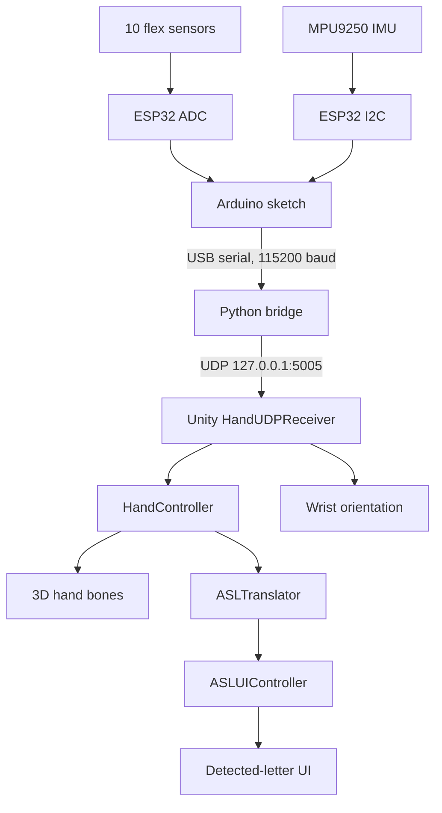

# ASL Translator — Smart Glove + 3D Unity Hand

A prototype sign-language handshape visualizer built around an ESP32, an MPU9250 IMU, ten flex sensors, a Python serial-to-UDP bridge, and a Unity 3D hand model.

> **Project status:** recovered prototype; source inspected, but end-to-end hardware operation has not been re-tested. The existing recognition logic has known limitations documented below. Do not describe it as a complete or clinically/educationally validated ASL translator.

## System architecture



1. The ESP32 reads the MPU9250 accelerometer/gyroscope and ten flex-sensor voltage dividers.
2. The Madgwick IMU filter estimates orientation and the sketch emits four quaternion components plus ten flex-sensor resistance values.
3. Python reads each serial line and forwards the same comma-separated payload as a UDP datagram.
4. Unity listens on UDP port `5005`, parses the 14 fields, updates wrist orientation and finger-angle values, and animates the hand model.
5. `ASLTranslator` compares the current finger-angle values with hard-coded conditions. `ASLUIController` appends newly detected letters while translation is enabled.

## Repository layout

```text
ASL-Translator/
├── Arduino/
│   ├── sketch_feb1a.ino
│   └── DEPENDENCIES.md
├── Python/
│   ├── arduino_to_udp.py
│   └── requirements.txt
├── Unity/
│   ├── Assets/
│   ├── Packages/
│   └── ProjectSettings/
├── Documentation/
│   ├── Architecture-and-Protocol.md
│   ├── Hardware-and-Dependencies.md
│   ├── Setup-and-Operation.md
│   ├── Inspection-Findings.md
│   └── screenshots/
├── .gitignore
├── LICENSE
└── README.md
```

Unity's `Library/`, `Temp/`, `Logs/`, `Obj/`, `Build/`, `Builds/`, and `UserSettings/` folders are generated or machine-specific and are excluded. Keep `Assets` `.meta` files, `Packages/manifest.json`, `Packages/packages-lock.json`, and all of `ProjectSettings/`.

## Requirements

- ESP32 development board supported by the Arduino IDE.
- MPU9250 IMU.
- Ten flex sensors and the fixed resistors listed in [hardware documentation](Documentation/Hardware-and-Dependencies.md).
- USB data cable and a serial port.
- Python 3.
- Unity Editor **6000.6.2f1** (recorded project version).
- Windows is required by the current `WindowsTTS.cs` / `System.Speech` implementation.

## Setup

### 1. Arduino

1. Open `Arduino/sketch_feb1a.ino` in Arduino IDE.
2. Install an Arduino library that provides `MadgwickAHRS.h` and the `Madgwick` API used by the sketch. The exact library package/version was not recorded in the recovered project; see [dependencies](Arduino/DEPENDENCIES.md).
3. Select the correct ESP32 board and its USB serial port.
4. Upload the sketch.
5. Confirm the serial monitor is set to `115200` baud. Close the serial monitor before starting Python because a serial port generally cannot be opened by both programs simultaneously.

### 2. Python bridge

From the repository root, create and activate a virtual environment, then install the dependency:

```bash
python -m venv .venv
# Windows:
.venv\Scripts\activate
# macOS/Linux:
source .venv/bin/activate

python -m pip install -r Python/requirements.txt
```

Edit `Python/arduino_to_udp.py` and change `SERIAL_PORT = "COM5"` to the ESP32's actual serial port. The baud rate must remain `115200`; the UDP destination is `127.0.0.1:5005`.

Run:

```bash
python Python/arduino_to_udp.py
```

### 3. Unity

1. Open Unity Hub.
2. Add the `Unity/` directory as an existing project.
3. Use Unity Editor `6000.6.2f1`.
4. Open `Assets/Scenes/SampleScene.unity`.
5. Allow Unity to regenerate `Library/` and import assets/packages.
6. Enter Play mode. The scene's `HandUDPReceiver` listens on UDP port `5005`.

The receiver binds to the local port when the scene starts. Start Unity before the Python bridge so the listener is ready before packets arrive.

### 4. Runtime controls

| Key | Action |
|---|---|
| `C` | Calibrate current IMU wrist pose as neutral |
| `Q` | Start letter accumulation |
| `E` | Stop letter accumulation |
| `W`, `A`, `S`, `D` | Move the camera |
| Right mouse button | Look around |
| Left Shift | Move faster |

The visible `startBtn` and `stopBtn` UI buttons in the recovered scene have empty `OnClick` event lists. The working start/stop controls in the recovered code are keyboard keys `Q` and `E`.

## Communication protocol

Each serial line and UDP datagram contains 14 comma-separated decimal values:

```text
q0,q1,q2,q3,thumbMCP,thumbPIP,indexMCP,indexPIP,middleMCP,middlePIP,ringMCP,ringPIP,pinkyMCP,pinkyPIP
```

- `q0`–`q3`: Madgwick quaternion values.
- Remaining ten values: calculated flex-sensor resistances in ohms, not raw ADC counts.
- Serial: `115200` baud, newline-terminated.
- UDP: IPv4 loopback `127.0.0.1`, destination port `5005`.

The Unity receiver constructs `Quaternion(q1, q2, q3, q0)` and then reorders its components again as `Quaternion(raw.y, raw.x, raw.z, raw.w)`. Preserve this behavior unless the IMU coordinate mapping is deliberately recalibrated and tested.

## Important recovered-code limitations

- Thumb sensor fields 4 and 5 are emitted by Arduino, but the corresponding two `ApplyFingerAngle` calls in `HandUDPReceiver.cs` are commented out. Unity's thumb angle fields therefore are not driven by the glove in the recovered implementation.
- The ASL classifier depends on thumb states for several letters, so those classifications cannot work as intended from live glove data until thumb mapping is restored and calibrated.
- `ASLTranslator.cs` contains identical predicates for C and O, H and U, and R and V. Because the first matching condition returns, O, U, and V are unreachable through those duplicated pairs.
- J and Z are not implemented. The classifier uses static finger-angle thresholds rather than motion sequences.
- `ASLTranslator.Update()` logs recognition continuously, even when the UI's translation mode is stopped.
- `ASLUIController` only appends a letter when it differs from the previous detected letter. `lastLetter` is not reset when the hand returns to an unrecognized pose or when translation restarts, so repeated identical letters cannot be appended consecutively.
- The UI start/stop buttons have no configured click handlers; use `Q` and `E`.
- The IMU filter is initialized with `filter.begin(50)`, while the main loop delays 10 ms (nominally about 100 Hz). The declared filter rate and loop rate do not match.
- UDP receive and Unity object field updates occur on a background thread. The receiver suppresses all exceptions, making runtime faults difficult to diagnose.
- The Python bridge is hard-coded to `COM5`, does not validate the 14-field packet, and does not implement serial reconnection.
- `WindowsTTS.cs` uses `System.Speech.Synthesis`; it is Windows-specific in practice. Its `Speak` method is not called by the recovered ASL UI code.
- The project includes `Assets/System.Speech.dll`. Verify its provenance and redistribution terms before publishing.
- The ZIP contains no recovered circuit diagram or project screenshots. Do not imply those assets are included.

See [inspection findings](Documentation/Inspection-Findings.md) before presenting the project as fully functional.

## Reproducibility and verification

The source tree and scene references were inspected from the recovered archive. The Unity project was not launched in the Unity Editor, the C# scripts were not compiled in this environment, and the hardware pipeline was not physically tested. A clean Unity import and an end-to-end test with the actual glove are still required.

A useful validation sequence is:

1. Verify each flex channel's resistance changes when bent.
2. Verify the ESP32 emits exactly 14 numeric fields per line at 115200 baud.
3. Verify the Python bridge opens the correct serial port and forwards packets to UDP port 5005.
4. Verify Unity receives datagrams and the wrist/finger values change.
5. Restore and calibrate thumb control, correct duplicate classifier rules, and test each supported handshape.
6. Confirm the UI and speech behavior on the intended Windows machine.

## License and third-party assets

The recovered project contains imported hand-model files, TextMesh Pro resources, and a `System.Speech.dll` binary. Their original licenses/provenance were not established from the archive. The included `LICENSE` file therefore records that no blanket reuse permission is granted. Replace it with a deliberate license only after verifying ownership and third-party asset terms.
# ASL-Interpreter

